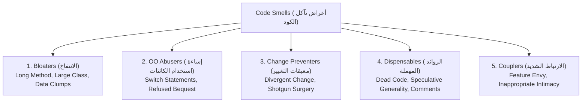

# Book 03: Refactoring: Improving the Design of Existing Code
**Author:** Martin Fowler (with contributions by Kent Beck)  
**Core Domain:** Code Smells, Structural Transformation & Safe Evolution  
**Key Themes:** Code Smells Catalog, Micro-Refactorings, Composed Methods, Test-Backed Restructuring.

---

## 1. Executive Summary & Core Thesis
Refactoring is the process of changing a software system in such a way that it does not alter the external behavior of the code yet improves its internal structure. It is a disciplined way to clean up code that minimizes the chances of introducing bugs. When done in small, continuous steps backed by automated unit tests, refactoring transforms a fragile legacy codebase into an adaptable, maintainable asset.

---

## 2. The Comprehensive Code Smells Taxonomy (روائح الكود)

The diagram uses Mika Mäntylä's five-group taxonomy. The candidate refactorings below use terminology from Fowler's catalog, including 2nd-edition names such as Long Function and Repeated Switches. [Mäntylä's taxonomy](https://mmantyla.github.io/BadCodeSmellsTaxonomy) · [Fowler's book and catalog](https://martinfowler.com/books/refactoring.html)



### A. The Most Critical Smells in Enterprise Software

Consider a candidate when it addresses a concrete maintenance problem and preserves behavior.

1. **Mysterious Name.** Consider Rename Variable or Rename Function when the current name hides intent.
2. **Duplicated Code.** Consider Extract Function when the code represents one rule that should change together.
3. **Long Parameter List.** Consider Introduce Parameter Object or Preserve Whole Object when fields form a cohesive concept.
4. **Global Data.** Consider Encapsulate Variable when shared access makes mutation hard to reason about.
5. **Mutable Data.** Consider limiting setters or separating ordinary queries from mutations when callers need predictable side effects.
6. **Divergent Change.** Consider Extract Class when a single class changes for independent reasons.
7. **Shotgun Surgery.** Consider moving functions together when one business change regularly requires edits across modules.
8. **Feature Envy.** Consider Move Function when it puts behavior next to the invariant and reduces coupling.
9. **Data Clumps.** Consider a parameter object or value object for fields that recur together and have shared meaning.
10. **Speculative Generality.** Consider collapsing an abstraction after confirming its extension points are unused.

---

## 3. High-Value Refactoring Techniques (التقنيات الأساسية)

### 1. Extract Function (استخراج الدالة)
* Extract a cohesive operation when naming it lets the caller read at a useful level of detail. Keep comments that explain an invariant or design reason.
  ```typescript
  // Before
  function printOwing(invoice: Invoice) {
    printBanner();
    // print details
    console.log(`name: ${invoice.customer}`);
    console.log(`amount: ${calculateOutstanding(invoice)}`);
  }

  // After
  function printOwing(invoice: Invoice) {
    printBanner();
    printDetails(invoice);
  }
  ```

### 2. Replace Conditional with Polymorphism (استبدال الشروط بالتعددية الشكلية)
* Consider polymorphism when several switches repeat decisions that vary independently by type. Keep a single exhaustive switch or match when it expresses a closed set of variants clearly. A table can be a good fit for data-only differences. [Fowler's refactoring catalog](https://refactoring.com/catalog/replaceConditionalWithPolymorphism.html)

### 3. Replace Primitive with Object (استبدال الأنواع البدائية بكائنات القيمة)
* Consider a value object when it centralizes validation or prevents invalid operations, such as adding amounts in different currencies.

### 4. Slide Statements & Decompose Conditional
* Reorder statements so that related state modifications live physically together, and break complex boolean expressions (`if (date.before(SUMMER_START) || date.after(SUMMER_END))`) into readable boolean functions (`if (isSummer(date))`).

---

## 4. The Golden Rule of Safe Refactoring
Fowler describes small behavior-preserving transformations and credits Kent Beck for the Two Hats metaphor. [Fowler's Two Hats example](https://martinfowler.com/articles/preparatory-refactoring-example.html#TheTwoHats)

Derived workflow. Record the relevant test baseline and existing working changes, make a small edit, and rerun focused checks. If the step introduced a regression, fix it or undo only that step while preserving previous work.

---

## 5. Actionable Rules for our Craftsmanship Skill
Use the derived [refactoring checklist](../checklists/refactoring-checklist.md) for working-tree safety, characterization tests, and handling existing failures. Keep structural edits distinguishable from behavior changes. Create separate commits only when authorized and useful to review.
