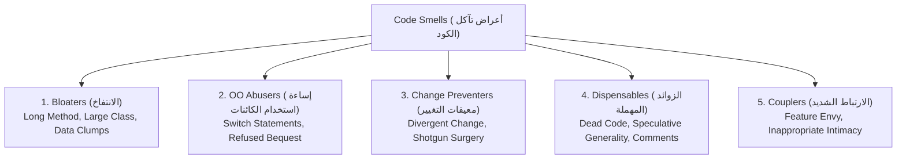

# Book 03: Refactoring: Improving the Design of Existing Code
**Author:** Martin Fowler (with contributions by Kent Beck)  
**Core Domain:** Code Smells, Structural Transformation & Safe Evolution  
**Key Themes:** Code Smells Catalog, Micro-Refactorings, Composed Methods, Test-Backed Restructuring.

---

## 1. Executive Summary & Core Thesis
Refactoring is the process of changing a software system in such a way that it does not alter the external behavior of the code yet improves its internal structure. It is a disciplined way to clean up code that minimizes the chances of introducing bugs. When done in small, continuous steps backed by automated unit tests, refactoring transforms a fragile legacy codebase into an adaptable, maintainable asset.

---

## 2. The Comprehensive Code Smells Taxonomy (روائح الكود)



### A. The Most Critical Smells in Enterprise Software
1. **Mysterious Name:** Names that require reading implementation lines to decipher intent $\rightarrow$ *Fix: Rename Variable / Rename Function.*
2. **Duplicated Code:** Identical or subtly different code blocks in multiple places $\rightarrow$ *Fix: Extract Function / Pull Up Method.*
3. **Long Parameter List:** Routines passing 5+ individual variables $\rightarrow$ *Fix: Introduce Parameter Object / Preserve Whole Object.*
4. **Global Data:** State accessible and mutable from anywhere $\rightarrow$ *Fix: Encapsulate Variable.*
5. **Mutable Data:** Unconstrained in-place state mutations across scopes $\rightarrow$ *Fix: Separate Query from Modifier / Remove Setting Method.*
6. **Divergent Change:** A single class is modified in different ways for different reasons (violates Single Responsibility) $\rightarrow$ *Fix: Split Class.*
7. **Shotgun Surgery:** A single business change requires making dozens of small edits across multiple different classes $\rightarrow$ *Fix: Move Function / Combine Functions into Class.*
8. **Feature Envy:** A method in Class A accesses data and methods of Class B far more than its own $\rightarrow$ *Fix: Move Function to Class B.*
9. **Data Clumps:** Groups of data items that always appear together (e.g., `city`, `street`, `postalCode`) $\rightarrow$ *Fix: Extract Class / Value Object.*
10. **Speculative Generality:** Complex abstractions, hooks, and inheritance hierarchies added "just in case" for future needs $\rightarrow$ *Fix: Collapse Hierarchy / Remove Dead Code.*

---

## 3. High-Value Refactoring Techniques (التقنيات الأساسية)

### 1. Extract Function (استخراج الدالة)
* Whenever code requires comments to explain what a block does, extract that block into a standalone function named after the **intent**, not the mechanism:
  ```typescript
  // Before
  function printOwing(invoice: Invoice) {
    printBanner();
    // print details
    console.log(`name: ${invoice.customer}`);
    console.log(`amount: ${calculateOutstanding(invoice)}`);
  }

  // After
  function printOwing(invoice: Invoice) {
    printBanner();
    printDetails(invoice);
  }
  ```

### 2. Replace Conditional with Polymorphism (استبدال الشروط بالتعددية الشكلية)
* Replace sprawling `switch(orderType)` statements with polymorphic strategy classes or specialized subclasses to eliminate Shotgun Surgery when new types are added.

### 3. Replace Primitive with Object (استبدال الأنواع البدائية بكائنات القيمة)
* Wrap primitive numbers/strings representing domain concepts into immutable Value Objects (e.g., wrapping a string into `PhoneNumber`, or a number into `Money`).

### 4. Slide Statements & Decompose Conditional
* Reorder statements so that related state modifications live physically together, and break complex boolean expressions (`if (date.before(SUMMER_START) || date.after(SUMMER_END))`) into readable boolean functions (`if (isSummer(date))`).

---

## 4. The Golden Rule of Safe Refactoring
> **"Refactoring must always be performed in micro-steps under the protection of green automated tests."**
* Step 1: Ensure all tests pass (Green).
* Step 2: Make a single mechanical change (e.g., rename or extract).
* Step 3: Run the test suite immediately.
* Step 4: If green, commit or proceed. If red, revert immediately—never debug inside an incomplete refactor.

---

## 5. Actionable Rules for our Craftsmanship Skill
1. **The Green-Bar Invariant:** Never initiate a structural refactoring on code that lacks automated test coverage. Write a baseline characterization test first.
2. **The Atomic Micro-Step Rule:** Refactoring commits must be separate from feature commits. A commit should either change behavior (feature) or change structure (refactoring), never both.
3. **The Data Clump Extractor:** Any 3 parameters appearing together in more than two function signatures must be converted into a typed Value Object.
