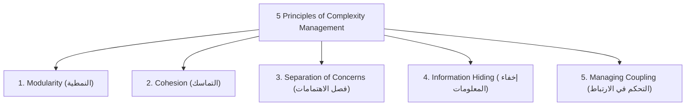

# Book 06: Modern Software Engineering
**Author:** David Farley (Co-author of Continuous Delivery)  
**Core Domain:** Engineering Methodology, Empiricism & Managing Complexity  
**Key Themes:** Iterative Experimentation, Testability as a Design Tool, Cohesion, Separation of Concerns.

---

## 1. Executive Summary & Core Thesis
Software engineering is the application of an empirical, scientific approach to finding efficient, economic solutions to practical problems in software. David Farley argues that true software engineering rests upon two foundational pillars: **Optimizing for Learning (Empiricism)** and **Managing Complexity**. Code construction must be treated as an experimental science driven by rapid feedback loops, testability, and modular decomposition.

---

## 2. Pillar 1: Optimizing for Learning (التعلم التجريبي السريع)

Software development is not a predictable manufacturing process; it is continuous exploration and discovery.
1. **Iterative & Incremental Delivery:** Breaking all technical tasks into tiny, working increments that can be evaluated against real feedback.
2. **Empirical Evidence over Dogma:** Measuring real execution metrics (latency percentiles, error rates, build times) rather than relying on theoretical assumptions.
3. **Hypothesis-Driven Development:** Every feature or architectural change is treated as an experiment: *Hypothesis $\rightarrow$ Testable Prediction $\rightarrow$ Execution $\rightarrow$ Measurement.*

---

## 3. Pillar 2: Managing Complexity (إدارة التعقيد البرمجي)

Farley identifies five fundamental engineering principles to tame complexity:

### 1. Modularity (النمطية)
* Breaking systems into autonomous, replaceable components with explicit contracts.

### 2. High Cohesion (التماسك العالي)
* Elements inside a module must belong together logically and change together for the same reasons. A class that handles order processing should not also calculate employee payroll.

### 3. Separation of Concerns (SoC)
* Separating business logic, persistence mechanics, UI presentation, and communication protocols into distinct layers.

### 4. Information Hiding / Abstraction
* Concealing volatile implementation details behind durable, stable interfaces.

### 5. Managing Coupling (Loose Coupling)
* Components interact through minimal, explicit dependencies. Tight coupling creates cascading fragility.

---

## 4. Testability as the Primary Architectural Design Tool
* **Farley’s Core Insight:** The primary value of automated testing is **not** finding bugs; it is **guiding code design**.
* If a class is difficult to write a unit test for, that code is whispering to you:
  - *"I am doing too many things (Poor Cohesion)."*
  - *"I have too many dependencies (Tight Coupling)."*
  - *"My interface is confusing (Poor Abstraction)."*
* **Rule:** If code is untestable, the design is broken. Fix the design, do not hack the test.

---

## 5. Actionable Rules for our Craftsmanship Skill
1. **The Testability Canary:** Any piece of code that requires extensive mocking or setup in a test must be treated as architectural defect evidence and refactored for loose coupling.
2. **The High Cohesion Mandate:** Every service, module, or package must represent a single, tightly knit responsibility; unrelated concerns must be split immediately.
3. **The Empirical Feedback Rule:** All performance and concurrency claims must be verified by automated benchmark tests in CI, never assumed by developer intuition.
