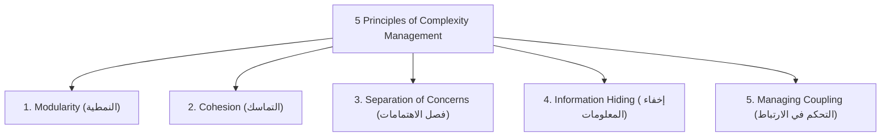

# Book 06: Modern Software Engineering
**Author:** David Farley (Co-author of Continuous Delivery)  
**Core Domain:** Engineering Methodology, Empiricism & Managing Complexity  
**Key Themes:** Iterative Experimentation, Testability as a Design Tool, Cohesion, Separation of Concerns.

---

## 1. Executive Summary & Core Thesis
Software engineering is the application of an empirical, scientific approach to finding efficient, economic solutions to practical problems in software. David Farley argues that true software engineering rests upon two foundational pillars: **Optimizing for Learning (Empiricism)** and **Managing Complexity**. Code construction must be treated as an experimental science driven by rapid feedback loops, testability, and modular decomposition.

---

## 2. Pillar 1: Optimizing for Learning (التعلم التجريبي السريع)

Software development is not a predictable manufacturing process; it is continuous exploration and discovery.
1. **Iterative & Incremental Delivery:** Breaking all technical tasks into tiny, working increments that can be evaluated against real feedback.
2. **Empirical Evidence over Dogma:** Measuring real execution metrics (latency percentiles, error rates, build times) rather than relying on theoretical assumptions.
3. **Farley's five learning practices.** The publisher's table of contents lists iteration, feedback, incrementalism, empiricism, and experimentation in Part II, Chapters 4–8. Chapter 8 lists sections on hypothesis and measurement. [InformIT publisher contents](https://www.informit.com/store/modern-software-engineering-doing-what-works-to-build-9780137314911)

---

## 3. Pillar 2: Managing Complexity (إدارة التعقيد البرمجي)

Farley identifies five fundamental engineering principles to tame complexity:

### 1. Modularity (النمطية)
* Breaking systems into autonomous, replaceable components with explicit contracts.

### 2. High Cohesion (التماسك العالي)
* Elements inside a module must belong together logically and change together for the same reasons. A class that handles order processing should not also calculate employee payroll.

### 3. Separation of Concerns (SoC)
* Separating business logic, persistence mechanics, UI presentation, and communication protocols into distinct layers.

### 4. Information Hiding / Abstraction
* Concealing volatile implementation details behind durable, stable interfaces.

### 5. Managing Coupling (Loose Coupling)
* Components interact through minimal, explicit dependencies. Tight coupling creates cascading fragility.

---

## 4. Testability as the Primary Architectural Design Tool
Farley covers testability and modularity in Chapter 9, separation of concerns and dependency injection in Chapter 11, and testability as a tool in Chapter 14. [InformIT publisher contents](https://www.informit.com/store/modern-software-engineering-doing-what-works-to-build-9780137314911)

---

## 5. Actionable Rules for our Craftsmanship Skill
1. **Testability (Derived).** Investigate heavy unit-test setup for coupled responsibilities. Use integration tests when the guarantee depends on real infrastructure.
2. **Cohesion (Derived).** Split behavior that changes independently when that makes the new modules easier to use and understand.
3. **Empirical feedback (Derived).** Verify concurrency behavior in an integration test. Measure performance-sensitive paths with a reproducible workload and the project's agreed budgets.
