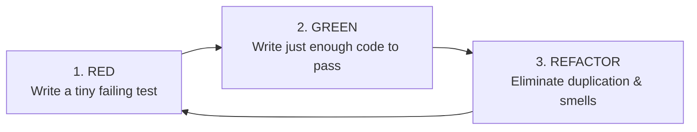

# Book 09: Test-Driven Development: By Example
**Author:** Kent Beck  
**Core Domain:** Test-Driven Development (TDD), Evolutionary Design & Feedback Loops  
**Key Themes:** Red-Green-Refactor, Triangulation, Test-First Design, Clean Code That Works.

---

## 1. Executive Summary & Core Thesis
Test-Driven Development is an awareness-altering discipline of software design. By writing an automated test *before* writing the production code, you shift your mindset from an implementer to a consumer of the code. TDD produces two invaluable outcomes: **clean code that works** and an automated safety net of tests that banishes fear from software development.

---

## 2. The Core TDD Rhythm: Red-Green-Refactor



1. **RED:** Write a small test that defines a single requirement. Run it and watch it fail (proving the test actually tests something and fails for the expected reason).
2. **GREEN:** Write the fastest, simplest code possible to make the test pass. It is completely acceptable to return hardcoded values ("fake it till you make it") at this stage.
3. **REFACTOR:** With all tests green, clean up the implementation, eliminate duplication, improve variable names, and apply design patterns without changing external behavior.

---

## 3. Key TDD Patterns & Strategies

### A. The Three Ways to Move from Red to Green
1. **Fake It (Till You Make It):** Return a hardcoded constant to get the test green quickly, then replace it with real logic as more tests are added.
2. **Triangulation (التثليث):** Write two or more tests with different inputs to force the implementation to generalize rather than rely on hardcoded shortcuts:
   ```typescript
   // Test 1 forces hardcoded return 10
   expect(add(5, 5)).toBe(10);
   // Test 2 forces generalized addition logic (a + b)
   expect(add(5, 7)).toBe(12);
   ```
3. **Obvious Implementation:** When the logic is simple and clear, write the real implementation immediately.

### B. The Money Pattern Case Study
* Kent Beck’s classic TDD walkthrough builds an enterprise Multi-Currency Money engine from scratch:
  - Demonstrates how to discover Value Objects (`Dollar`, `Franc`, `Money`) through incremental tests.
  - Proves how equality, immutability, and currency conversion naturally evolve from failing test specifications without top-down speculative architecture.

---

## 4. TDD as a Design Tool, Not a Testing Tool
* TDD forces loose coupling: because the code must be instantiated easily in an isolated test, it naturally forces dependency injection, small classes, and clear interfaces.
* TDD eliminates speculative coding (YAGNI): you never write a single line of production code unless forced to do so by a failing test.

---

## 5. Actionable Rules for our Craftsmanship Skill
1. **The Test-First Mandate:** Core domain logic and calculation engines (pricing, tax compounding, inventory cost averaging) must be authored strictly test-first.
2. **The Red Verification Rule:** Never trust a test that you haven't seen fail at least once.
3. **The Refactoring Safety Rule:** Never refactor on a Red bar. Refactoring is strictly a Green-bar activity.
