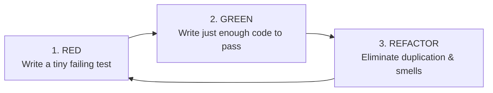

# Book 09: Test-Driven Development: By Example
**Author:** Kent Beck  
**Core Domain:** Test-Driven Development (TDD), Evolutionary Design & Feedback Loops  
**Key Themes:** Red-Green-Refactor, Triangulation, Test-First Design, Clean Code That Works.

---

## 1. Executive Summary & Core Thesis
Test-driven development uses a test written before the implementation to define the next behavior from the caller's perspective. Beck walks through the Money and xUnit examples, then catalogs TDD patterns. [Pearson publisher description and contents](https://www.pearson.com/en-us/subject-catalog/p/test-driven-development-by-example/P200000009421/9780321146533)

---

## 2. The Core TDD Rhythm: Red-Green-Refactor



1. **RED:** Write a small test that defines a single requirement. Run it and watch it fail (proving the test actually tests something and fails for the expected reason).
2. **GREEN:** Write just enough code for the intended case. A temporary constant can provide feedback in a local experiment. Generalize and verify the behavior before shipping.
3. **REFACTOR:** With the relevant tests green, improve structure while preserving behavior.

---

## 3. Key TDD Patterns & Strategies

### A. The Three Ways to Move from Red to Green
1. **Fake It (Till You Make It):** Return a hardcoded constant to get the test green quickly, then replace it with real logic as more tests are added.
2. **Triangulation (التثليث):** Write two or more tests with different inputs to force the implementation to generalize rather than rely on hardcoded shortcuts:
   ```typescript
   // Test 1 forces hardcoded return 10
   expect(add(5, 5)).toBe(10);
   // Test 2 forces generalized addition logic (a + b)
   expect(add(5, 7)).toBe(12);
   ```
3. **Obvious Implementation:** When the logic is simple and clear, write the real implementation immediately.

### B. The Money Pattern Case Study
Part I uses a multi-currency example to explore equality, addition, mixed currencies, and abstraction through small steps. [Pearson publisher contents](https://www.pearson.com/en-us/subject-catalog/p/test-driven-development-by-example/P200000009421/9780321146533)

---

## 4. TDD as a Design Tool, Not a Testing Tool
Designing the first test from a caller's point of view can expose awkward interfaces. The red–green loop helps limit scope to the next behavior. Evaluate longer-term module boundaries alongside that feedback.

---

## 5. Actionable Rules for our Craftsmanship Skill
1. **Test-first default (Derived).** Prefer Red–Green–Refactor for logic-heavy work such as pricing and costing when a small failing test expresses the behavior. A behavior-preserving refactor can use existing coverage or characterization tests.
2. **Verify the red step (Derived).** When using TDD, confirm the new test fails for the intended reason, then rerun it and the relevant suite after implementing the change.
3. **Baseline issues (Derived).** Record pre-existing failures before restructuring and compare with focused checks. Follow the [refactoring checklist](../checklists/refactoring-checklist.md) to preserve existing work and the [testing checklist](../checklists/unit-testing-checklist.md) to choose the right verification level.
